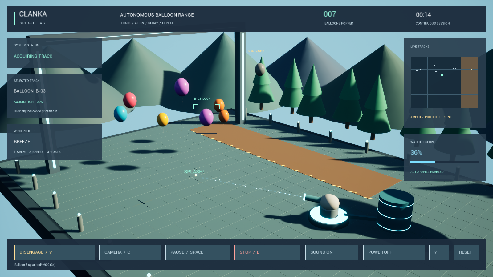

# Clanka Splash Lab

**Switch ON. ENGAGE. Enjoy the show.**

A continuous virtual balloon range built with Unreal Engine 5.8 and an engine-independent C++ simulation. A little water cannon tracks colorful balloons, lines up, and sprays them while the laboratory keeps running. This is a relaxed proof of concept: no timed challenge, win condition, or physical hardware connection.



## What's inside

- A stylized floating laboratory with luminous lanes, mountains, clouds, and a water cannon.
- Automatic balloon selection, tracking, virtual water, and balloon respawning.
- A protected zone that excludes balloons from spraying.
- Automatic tank refills, three wind profiles, and three camera views with zoom.
- Balloon pop effects, original synthesized sounds, and ambient audio.
- Clickable controls, pause, a latched stop, and session logging.

## Play in Unreal

Open **`Clanka.uproject`** in Unreal Engine 5.8, then press **Play**. Click **POWER ON** to start tracking and **ENGAGE** to enable virtual water. The simulation continues until you power it off.

The verified standalone Windows launcher is **`PackagedUnreal/Windows/Clanka.exe`**. Double-click **`PlayClanka.cmd`** from the project folder, then **POWER ON** and **ENGAGE**. Keep the complete packaged directory together when distributing it. The local archive is `PackagedUnreal/Clanka-Unreal-Windows.zip`; extract it and run `Clanka.exe`.

The Git repository includes source, editable Unreal content, and the small legacy preview. Unreal build output and the large standalone distribution are excluded from Git; generate the package with the commands below after cloning.

## Controls

| Control | Action |
|---|---|
| Enter | Power on; engage water when powered |
| G | Engage water |
| V | Toggle water authorization while powered |
| Click a balloon | Prioritize an eligible track |
| Space / P | Pause or resume |
| E / T | Latch / release the stop; engage again after release |
| F | Refill manually |
| 1 / 2 / 3 | Calm / breeze / gusts |
| C | Cycle camera views |
| Mouse wheel | Zoom |
| M | Toggle sound |
| H | Show or hide help |
| L | Save the session log |
| R | Reset the simulation |
| Esc | Power off; quit when already off |

Main actions also have on-screen buttons. Unreal saves **`Saved/SessionLog.csv`** and **`Saved/BestScore.txt`**. Exporting a log overwrites the previous log.

## Build and verify

Requirements: Unreal Engine 5.8, a supported modern Visual Studio C++ toolchain, and a Windows SDK. Enable Unreal's Python Editor Script Plugin for content preparation. Python is used only to prepare assets; the game backend is C++.

Run from this project directory in PowerShell:

```powershell
# Build the editor module, create/import content, and generate the Unreal solution.
.\Tools\PrepareUnreal.ps1

# Build the standalone game target.
.\Tools\Build.ps1 -Target Game

# Cook assets and assemble the standalone Windows distribution.
.\Tools\PackageUnreal.ps1

# Run the engine-independent C++ behavior checks.
.\Tools\Test.cmd
```

The scripts accept `-Engine "D:\Path\To\UE_5.8"` when Unreal is installed elsewhere. Solution generation currently selects Visual Studio 2026. First builds and asset cooking can take time. `PrepareUnreal.ps1` and `PackageUnreal.ps1` accept `-DataCache "D:\UnrealCache"`; packaging also accepts `-StagingDirectory "D:\UnrealStage"` to keep temporary files off a crowded system drive.

Content preparation creates missing materials and a map, and imports the included original WAV files. Existing maps and materials are preserved. To regenerate the audio sources, run `python Tools/GenerateAudio.py` before preparation.

### Verification status

- **Passed:** 39 core simulation checks, including separate power/engage, stop latching, automatic refill, and continuous operation past 180 seconds.
- **Passed:** Unreal editor and standalone Game target compilation with Unreal 5.8.2.
- **Passed:** content bootstrap execution with zero errors.
- **Passed:** Windows cook, stage, and archive (Development configuration).
- **Passed:** the packaged executable's `-DemoTest` run: 9 balloons popped in 19.72 simulated seconds, a rendered screenshot, and clean exit. No runtime errors or missing material-usage warnings were reported.
- **Passed:** Visual Studio 2019 launcher build and five executable-resolution checks.
- **Not yet verified:** direct mouse interaction through the desktop-control service, which denied access to the new executable. Backend action tests and the packaged automatic run passed independently.

To repeat the packaged smoke test, run `Clanka.exe -DemoTest`. It powers on, engages, saves `Clanka/Saved/UnrealDemo.png` and `UnrealDemoResult.json`, then exits after approximately 20 seconds. Normal startup stays at the POWER ON screen. On the development PC the build used MSVC 14.51 and Windows SDK 10.0.26100; Unreal warned that this compiler is newer than its preferred version, but both builds succeeded.

## Visual Studio 2019 and the native preview

**`ClankaDemo.sln`** is the Visual Studio 2019-compatible C# launcher solution. Press **F5** to launch **`PackagedUnreal/Windows/Clanka.exe`** when the Unreal package is present. Otherwise it falls back to **`WindowsDemo/ClankaSplashLab.exe`**, the legacy native Windows preview with its own timed session and controls. The solution also builds that fallback preview. F5 debugs the launcher; it does not attach the debugger to the Unreal game.

For the Unreal game, use **`Clanka.uproject`** and a supported modern Visual Studio IDE/toolchain. Visual Studio 2019 is not the Unreal 5.8 development target.

Rebuild the legacy preview with `Tools/BuildPreview.cmd`.

## Project guide

| File / directory | Purpose |
|---|---|
| `Clanka.uproject` | Unreal project entry point |
| `Source/Clanka/Simulation.h` | Deterministic C++ backend, advancing at 120 steps per second |
| `Source/Clanka/SplashWorld.cpp` | Runtime arena, cameras, effects, audio, and input |
| `Source/Clanka/SplashHUD.cpp` | On-screen interface |
| `Tests/SimulationTests.cpp` | Core behavior checks |
| `Tools/CreateContent.py` | Unreal material, sound, and map preparation |
| `Tools/GenerateAudio.py` | Original synthesized audio generation |
| `Preview/` and `Launcher/` | Legacy native preview and VS2019 launcher |

Tracking confidence, balloon motion, and water exposure are simulated game variables. Visible droplets are cosmetic. The program demonstrates virtual behavior and has no camera, valve, servo, or other hardware integration.
