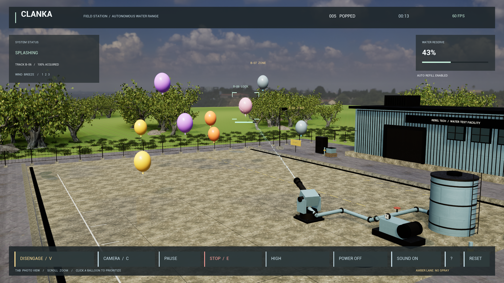

# Clanka Splash Lab

**POWER ON. ENGAGE. Enjoy the show.**

An automatic balloon range built with Unreal Engine 5.8 and an engine-independent C++ simulation. The cannon selects, tracks and sprays floating balloons; the tank refills and balloons respawn continuously. Power and engagement are separate controls.



## The graphics upgrade

A weathered industrial courtyard with 4K concrete, photographed grass, masked foliage, painted metal, a workshop, fenced service yard, detailed cannon and plumbing, daylight, damp-surface reflections and glossy latex balloons. Three graphics presets and a live FPS display let you adjust the scene for your PC. **Q** cycles presets; **Tab** hides the interface for a clear view.

Assets are included in `Content/Realism`. The game needs no download or Python installation to run. Source assets are CC0; see [asset credits](ASSET-CREDITS.md).

## Play

Double-click **`PlayClanka.cmd`**, then click **POWER ON** and **ENGAGE**. The standalone executable is **`PackagedUnreal/Windows/Clanka.exe`**. Keep its complete directory together. The local portable archive is `PackagedUnreal/Clanka-Realism-Windows.zip`; extract it and run `Clanka.exe`.

Open **`Clanka.uproject`** in Unreal Engine 5.8 to edit the game. The Git repository includes source and editable content; large build output and the packaged distribution are excluded.

## Controls

| Control | Action |
|---|---|
| Enter | Power on; engage when powered |
| G / V | Engage / toggle water authorization |
| Click a balloon | Prioritize an eligible track |
| Space / P | Pause or resume |
| E / T | Latch / release stop; engage again after release |
| F | Refill manually |
| 1 / 2 / 3 | Calm / breeze / gusts |
| C / mouse wheel | Cycle cameras / zoom |
| Q | Cycle Performance, Balanced, High graphics |
| Tab | Hide or show interface |
| M / H | Sound / help |
| L | Export session log |
| R | Reset |
| Esc | Power off; quit when already off |

Main actions have on-screen buttons. Quality selection persists in `Saved/ClankaSettings.ini`. Session exports overwrite `Saved/SessionLog.csv`. In the packaged game these files are under `Clanka/Saved`.

## Performance and verification

The default Balanced preset renders at native resolution, with 2K shadows, screen-space reflections and ambient occlusion. Performance uses 83% internal resolution and lighter shadows. High increases shadow and reflection quality and adds screen-space indirect lighting. All presets cap at 60 FPS and use DirectX 11; Lumen, hardware ray tracing and volumetric fog are disabled.

Verified on Raven (GTX 1060 6 GB, i7-9700K, 16 GB RAM): the High preset at native 1920x1080 averaged **59.98 FPS** across all three cameras. The 99th-percentile frame took **16.72 ms**; the slowest measured frame was **31.84 ms**, with no measured frame over 33.33 ms. This measurement excludes startup and screenshot capture windows. The 65-second automatic run popped 27 balloons. [Inspect the frame-time report and screenshots](Media/Benchmarks/20261012-150206-Q2).

Build/cook/package completed successfully, all **39 core simulation checks** passed, and the packaged game passed **11 HUD-handler integration checks**. Direct desktop mouse interaction was not exercised by automation. Unreal 5.8 marks the High preset's SSGI path deprecated; it works in this pinned engine version and should be revisited for a future engine upgrade.

Run the packaged benchmark on your PC:

```powershell
.\Tools\Benchmark.ps1 -Quality 1 -Width 1920 -Height 1080
```

It runs for 65 seconds, automatically engages the range, visits all three cameras and writes JSON, frame-time CSV and screenshots into `Media/Benchmarks`. Measurements use actual frame intervals after ten seconds of warmup, excluding screenshot capture windows. The report records output resolution, internal render percentage, average FPS and frame-time percentiles.

`Clanka.exe -InteractionTest` exercises eleven checks through the actual HUD button handlers, including separate power/engage, automatic popping, pause, stop, power off and reset. It writes `Clanka/Saved/InteractionTest.json` and exits. This does not inject desktop mouse clicks.

`Clanka.exe -DemoTest` runs a 20-second automatic smoke test and writes a screenshot and result JSON. `-MenuCapture` captures the normal start screen and exits after eight seconds.

## Build in Visual Studio

**`ClankaDemo.sln`** is the Visual Studio 2019-compatible C# launcher solution. Press **F5** to launch the packaged Unreal executable. If no package exists it falls back to the legacy native Windows preview. F5 debugs the launcher, not the Unreal process.

**Unreal 5.8 itself requires a supported modern Visual Studio C++ toolchain.** Use `Clanka.uproject` or generate `Clanka.sln` / `Clanka.slnx` with `Tools/Build.ps1 -Target Solution`. The Raven build uses Unreal 5.8.2, MSVC 14.51 and Windows SDK 10.0.26100. The compiler is newer than Unreal's preferred version and emits a warning.

From the project directory in PowerShell:

```powershell
# Build editor module; prepare the original map/audio if missing; generate solution.
.\Tools\PrepareUnreal.ps1

# Build, cook and archive the Windows game.
.\Tools\PackageUnreal.ps1 -DataCache 'D:\UnrealCache' -StagingDirectory 'D:\UnrealStage'

# Engine-independent C++ behavior checks.
.\Tools\Test.cmd
```

Scripts accept `-Engine 'D:\Path\To\UE_5.8'` for a different engine location. Builds use one compiler action at a time to limit memory pressure on 16 GB machines. Initial compilation and cooking take longer than incremental builds.

The committed realism assets need no reimport. To recreate them from their original CC0 sources, install Python and Blender, then run:

```powershell
python Tools/DownloadRealism.py --blender 'C:\Path\To\blender.exe'
.\Tools\PrepareRealism.ps1 -DataCache 'D:\UnrealCache'
```

This downloads the source kit into ignored `AssetsSource/`, prepares meshes, and imports textures/materials/models with Unreal's Python editor plugin. The finished game backend is C++; Python and Blender are authoring tools only.

## Source guide

| Path | Purpose |
|---|---|
| `Source/Clanka/Simulation.h` | Deterministic simulation at 120 steps per second |
| `Source/Clanka/SplashEnvironment.cpp` | Instanced scenery, workshop, vegetation and cannon |
| `Source/Clanka/SplashWorld.cpp` | Lighting, cameras, effects, audio and input |
| `Source/Clanka/SplashHUD.cpp` | Clickable interface |
| `Source/Clanka/SplashDiagnostics.cpp` | Presets, benchmark and HUD integration checks |
| `Tests/SimulationTests.cpp` | 39 core behavior checks |
| `Tools/PrepareRealism.py` | Reproducible Unreal asset/material importer |
| `Launcher/` | C# launcher for Visual Studio 2019 |
| `Preview/` | Legacy native preview |

The simulation demonstrates virtual behavior. Tracking confidence, motion and water exposure are game variables; visible droplets are cosmetic. There is no camera, valve, servo or physical hardware connection.
